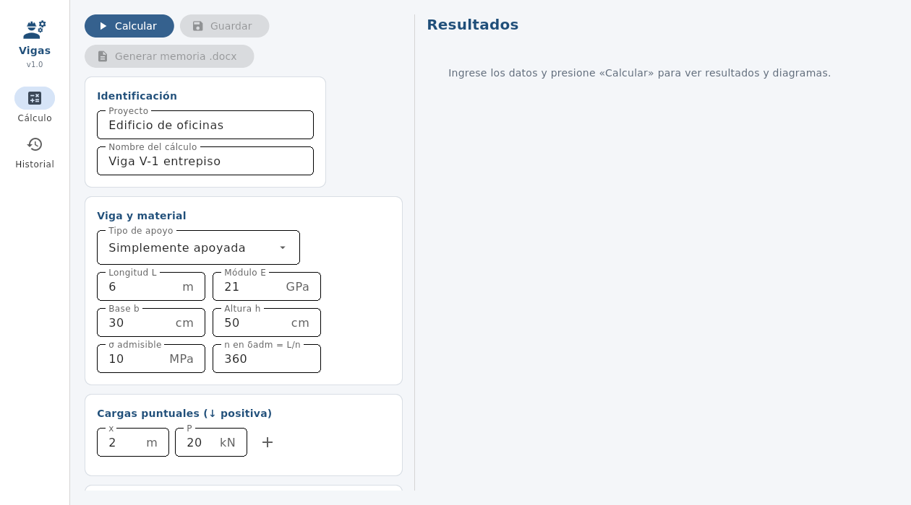
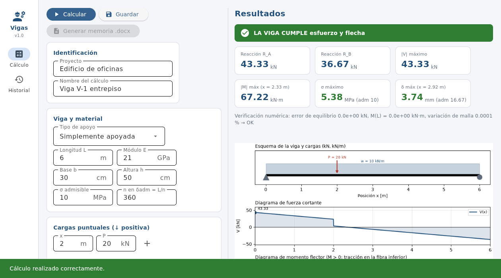
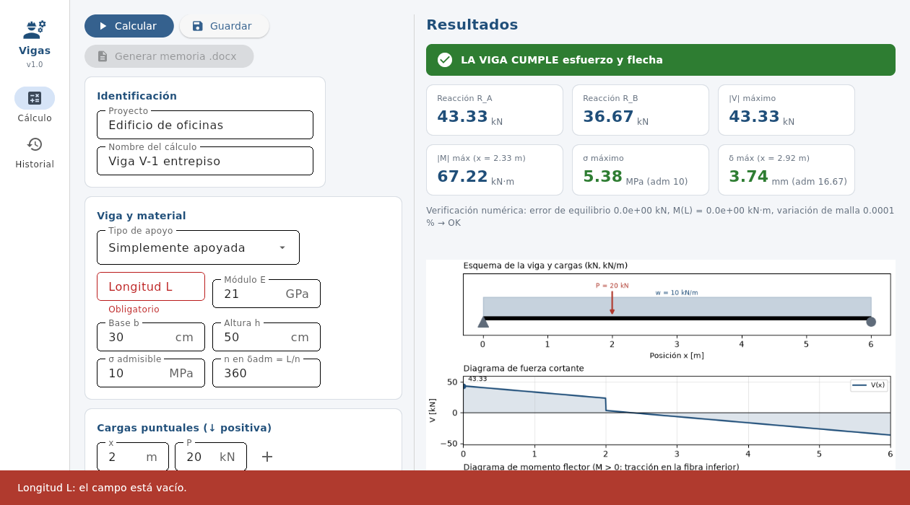
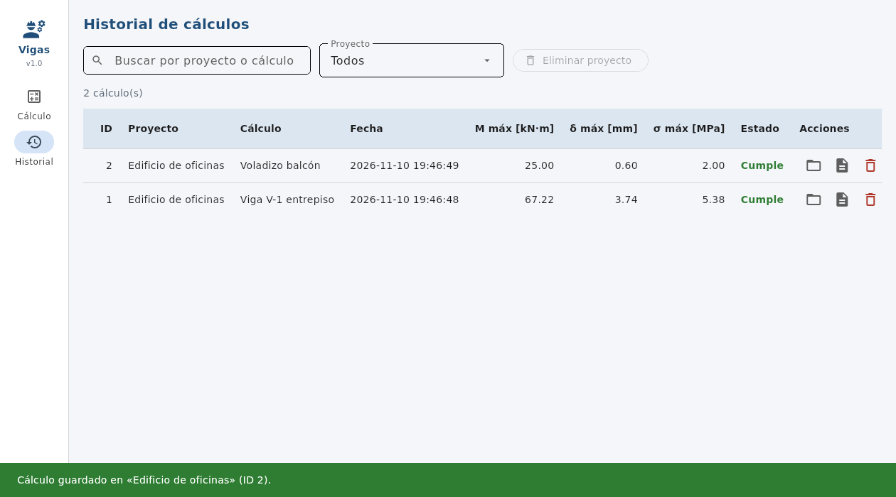

# Análisis de Vigas — Cortante, Momento y Deflexión

Aplicación de escritorio para ingeniería civil (Proyecto 02, Programación II, Universidad Distrital Francisco José de Caldas, 2026-III, Grupo 18).
Calcula **reacciones, diagramas de fuerza cortante V(x), momento flector M(x), pendiente y deflexión δ(x)** de una viga isostática con cargas puntuales y distribuidas arbitrarias, verifica **esfuerzo por flexión** y **flecha admisible**, guarda los cálculos en **SQLite** y genera automáticamente la **memoria de cálculo en Word**.

| Herramienta | Uso en el proyecto |
|---|---|
| Flet | Interfaz con panel lateral, 2 vistas (Cálculo, Historial), validación y SnackBar/diálogos |
| NumPy | Cálculo vectorizado de V(x) y M(x) (broadcasting contra todas las cargas, sin ciclos `for`) |
| SciPy | `scipy.integrate.cumulative_trapezoid` para integrar M/EI dos veces y obtener θ(x) y δ(x) |
| Matplotlib | Esquema de cargas + diagramas V, M y δ (se ven en la app y se insertan en el Word) |
| SQLite | Tablas `proyectos` y `calculos` (llave foránea), CRUD completo, consultas parametrizadas |
| docxtpl | `plantillas/memoria.docx` con ciclos `` e `InlineImage` |

## Capturas

| Formulario | Resultados y gráficas |
|---|---|
|  |  |
| **Validación de entradas** | **Historial** |
|  |  |

Ejemplo de memoria generada: [`ejemplos/memoria_ejemplo.docx`](ejemplos/memoria_ejemplo.docx).

## Fundamento teórico

Convenciones: cargas hacia abajo positivas; M positivo = tracción en la fibra inferior; V = dM/dx; y positivo hacia arriba y δ = −y (positivo hacia abajo).

- Sección rectangular: `I = b·h³/12`, `S = b·h²/6`.
- Equilibrio: `ΣFy = 0`, `ΣM = 0`. Simple: `R_B = (ΣP·a + ΣW·c)/L`, `R_A = ΣP + ΣW − R_B`. Voladizo (empotrado en x = 0): `R = ΣP + ΣW`, `M₀ = −(ΣP·a + ΣW·c)`; con `W = w·(b−a)` y `c = (a+b)/2`.
- Método de secciones (vectorizado): `V(x) = R₀ − ΣP·H(x−a) − Σ w·t`, `M(x) = M₀ + R₀·x − ΣP·(x−a)₊ − Σ w·t·(x−a−t/2)`, con `t = clip(x−a, 0, b−a)`.
- Elástica (Euler–Bernoulli): `E·I·y'' = M(x)`. Se integra dos veces con `cumulative_trapezoid`: `θ₀ = ∫M/EI dx`, `y₀ = ∫θ₀ dx`.
  - Voladizo: `θ(0) = 0`, `y(0) = 0`.
  - Simple: `y(0) = y(L) = 0` ⇒ `y = y₀ + C₁x`, `C₁ = −y₀(L)/L`.
- Chequeos: `σmax = |Mmax|/S ≤ σadm` y `δmax ≤ L/n` (por defecto n = 360; para voladizos suele usarse 180; ajuste el valor según la norma o el criterio del proyecto, p. ej. NSR-10 Título C).

**¿Por qué SciPy?** M(x) es continua y por tramos; la deflexión se obtiene integrando numéricamente la curvatura M/EI, que es justo el uso ingenieril de la cuadratura acumulada. Esto permite cargas arbitrarias sin deducir una fórmula por cada combinación. El error de la regla del trapecio es O(h²); la app lo comprueba duplicando los puntos (variación de δmax < 0.1 %).

### Unidades

L [m] · P [kN] · w [kN/m] · V [kN] · M [kN·m] · E [GPa] · b, h [cm] · I [m⁴] · EI [kN·m²] · δ [mm] · σ [MPa]. Conversión usada: 1 GPa = 10⁶ kN/m². Coherencia: σ = M/S → kN·m / m³ = kPa → ×10⁻³ = MPa.

## Instalación

Requiere Python 3.12 (versión con la que se probó).

```bash
git clone <URL-DEL-REPOSITORIO>
cd <carpeta-del-repositorio>
python -m venv .venv
# Windows:      .venv\Scripts\activate
# macOS/Linux:  source .venv/bin/activate
pip install -r requirements.txt
python main.py
```

La base de datos (`datos/proyectos.db`) se crea sola al abrir la aplicación (`CREATE TABLE IF NOT EXISTS`). Las memorias se guardan en `salidas/`. Ambas carpetas están en `.gitignore`.

## Uso paso a paso

1. En **Cálculo**, escriba proyecto y nombre, elija el apoyo, complete longitud, E, sección, σ admisible y n de flecha.
2. Agregue cargas con el botón **+** (las listas permiten quitarlas). La app arranca con el caso resuelto a mano (w = 10 kN/m, L = 6 m).
3. **Calcular** → métricas, banner *cumple / no cumple*, verificación numérica y diagramas.
4. **Guardar** → almacena el cálculo en SQLite. **Generar memoria .docx** → crea el Word y lo abre.
5. En **Historial**: buscar por texto, filtrar por proyecto, **abrir** (reabre y recalcula), generar memoria o **eliminar** (con confirmación); también se puede eliminar un proyecto completo.

Si un campo está vacío o contiene letras, el campo se marca en rojo y aparece un mensaje; la aplicación no se cierra.

## Pruebas

```bash
pytest
```

- `tests/test_modelo.py`: **caso resuelto a mano** (viga simple, w = 10 kN/m, L = 6 m, 30×50 cm, E = 21 GPa: R = 30 kN, Mmax = 45 kN·m, σ = 3.6 MPa, δ = 2.571 mm) y casos de la literatura (carga puntual central `PL³/48EI`, voladizo con carga en el extremo `PL³/3EI`, voladizo uniforme `wL⁴/8EI`), superposición, condiciones de borde, validaciones.
- `tests/test_db.py`: tablas automáticas, CRUD, cascada, llave foránea, inyección SQL, persistencia al reabrir.
- `tests/test_reporte.py`: el Word contiene datos, tabla generada con `for` y la gráfica.

## Estructura

```
main.py                  # punto de entrada
requirements.txt  README.md  .gitignore  pytest.ini
app/
  modelo.py              # ingeniería (NumPy/SciPy), sin Flet
  db.py                  # SQLite (todo el SQL)
  graficas.py            # figuras de Matplotlib
  reporte.py             # memoria .docx con docxtpl
  ui/                    # vistas Flet (ventana, vista_calculo, vista_historial, tema)
plantillas/memoria.docx  # plantilla Jinja
scripts/                 # crear_plantilla.py, generar_capturas.py
tests/                   # pytest
ejemplos/                # memoria_ejemplo.docx y capturas/
docs/guia_sustentacion.md
```

## Subir a GitHub

```bash
git init -b main
git add .
git commit -m "Modelo de vigas con NumPy/SciPy y pruebas"
git remote add origin https://github.com/USUARIO/REPO.git
git push -u origin main
```

Luego, en GitHub: *Settings → Collaborators* para agregar a ambos integrantes. Cada integrante debe hacer sus propios commits desde su cuenta (`git config user.name` / `user.email`) y, antes de entregar, verificar con `git log --oneline` que el historial sea descriptivo.

## Limitaciones conocidas

Vigas isostáticas (simple y voladizo), sección rectangular, cargas puntuales y distribuidas uniformes (sin triangulares ni momentos aplicados), un solo material. La flecha es instantánea elástica (no incluye fluencia).

## Referencias

- Hibbeler, R. C. *Mecánica de materiales*. Pearson.
- Gere, J. M. & Goodno, B. J. *Mechanics of Materials*. Cengage.
- Reglamento Colombiano de Construcción Sismo Resistente NSR-10, Título C (control de deflexiones).
- Documentación de [Flet](https://flet.dev), [NumPy](https://numpy.org), [SciPy](https://scipy.org), [Matplotlib](https://matplotlib.org), [docxtpl](https://docxtpl.readthedocs.io).

## Autores

- Sebastián Hernández — código 20231579036
- _(compañero/a: nombre y código)_

Para que el compañero/a aparezca también en la memoria Word, agréguelo/a a la lista `AUTORES` de `app/reporte.py`.
